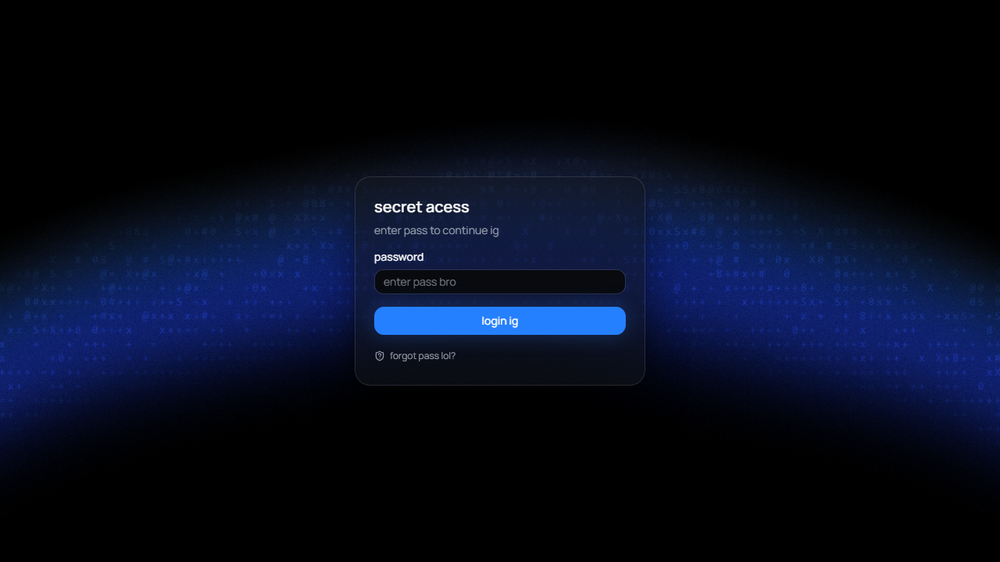

# password

A playful prank "password-protected secret page" rebuilt as a modern React + Vite app with animated visuals.

**Live demo:** https://chandrasen74.github.io/password/  
**Repository:** https://github.com/Chandrasen74/password



## Overview
This project is a front-end prank/experiment: a fake password gate that reveals a themed secret page. Enter the password, pick a grade/theme, and the UI/background shifts with animated effects.

### What it does
- Password gate flow (try the classic password to get in, with a few joke responses)
- Theme/grade selection that changes the page look and background behavior
- Playful UI interactions (including prank "copy" actions)
- Animated ASCII/gradient-style background visuals

## Tech stack / languages
- **TypeScript** (primary)
- **React 19**
- **Vite 6**
- **Tailwind CSS v4** (`@tailwindcss/vite`)
- UI/components: `@base-ui/react`, coss ui component copies, `lucide-react` / icons
- Animation/visuals: motion, custom `GradientASCII` component (WebGL2-based)

## Prerequisites
- **Node.js** (LTS recommended)
- **npm** (comes with Node.js)

## Install & run locally
```bash
git clone https://github.com/Chandrasen74/password.git
cd password
npm install
npm run dev
```
Then open the local URL shown by Vite (typically `http://localhost:5173`).

## Build & preview
```bash
# type-check + production build (outputs to docs/ for GitHub Pages)
npm run build

# preview the production build locally
npm run preview
```

## Project structure
- `src/` - app source (React/TypeScript), components, styles, assets
  - `src/App.tsx` - main app shell/views/theme behavior
  - `src/components/` - UI and visual components (including `GradientASCII`)
- `public/` - static assets
- `docs/` - built site output served by GitHub Pages
- `index.html`, `vite.config.ts`, `tsconfig.json` - tooling/config

## Deployment
Hosted on **GitHub Pages** from the `docs/` folder on `main`: https://chandrasen74.github.io/password/

## Notes
- This is a creative/prank experiment, not a real security mechanism.
- Commits in this repo may be signed (Verified) depending on local git signing setup.
